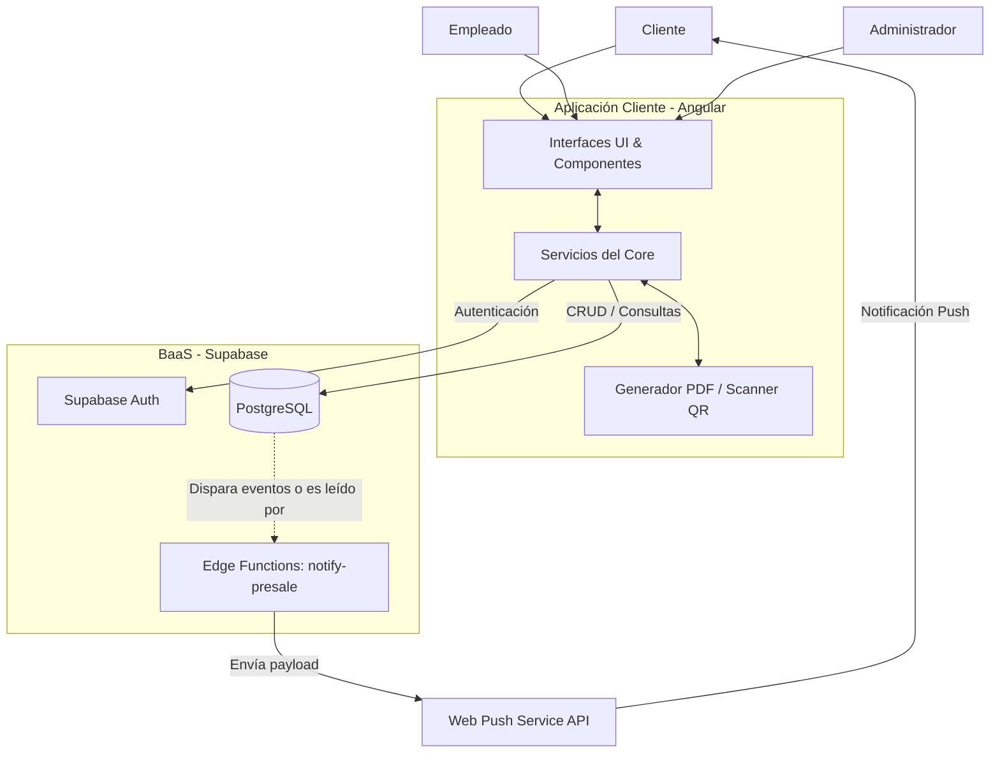

# CINEMARDO

## 1. Descripción del proyecto

CINEMARDO es una aplicación web integral diseñada para la gestión y reserva de entradas de un cine. Su objetivo principal es ofrecer una experiencia fluida tanto para los clientes que desean comprar entradas y combos (candy bar), como para los empleados y administradores del establecimiento. 

### Principales funcionalidades:
- **Cartelera y Estrenos:** Visualización de películas en cartelera, los estrenos próximos y las películas más vendidas.
- **Reserva de Entradas:** Flujo completo de compra (Booking flow) que incluye selección de función, selección de butacas interactiva, agregado de combos de Candy Bar y pago virtual.
- **Generación de Tickets:** Generación de comprobantes en PDF con códigos QR utilizando `jspdf` y `html2canvas`.
- **Alertas de Preventa:** Sistema de suscripción a alertas de preventa mediante notificaciones Push para próximos estrenos.
- **Escaneo de Entradas:** Herramienta interna para que los empleados escaneen los códigos QR de los clientes en el ingreso, validando los tickets y la entrega del Candy Bar en tiempo real.
- **Dashboard Administrativo:** Panel de control para que los administradores puedan visualizar las métricas y el estado del negocio.

### Roles de usuario:
1. **Cliente / Usuario Estándar:** Puede navegar la cartelera, comprar tickets y combos, suscribirse a alertas de próximos estrenos, y ver su perfil.
2. **Empleado:** Tiene acceso al escáner de códigos QR para validar entradas y marcar la entrega de productos del Candy Bar.
3. **Administrador:** Tiene acceso al Dashboard para visualizar estadísticas generales del sistema y gestionar la plataforma.

---

## 2. Stack tecnológico

El proyecto está desarrollado utilizando una arquitectura de frontend moderno (SPA) apoyado por un Backend-as-a-Service (BaaS) robusto.

### Frontend
- **Angular (v22+):** Framework principal utilizado para la construcción de la Single Page Application (SPA), aprovechando su sistema de enrutamiento y reactividad.
- **SCSS:** Preprocesador CSS para los estilos de la aplicación, permitiendo un diseño modular y estructurado.
- **RxJS:** Librería utilizada para la programación reactiva y el manejo de flujos de datos asíncronos en Angular.

### Backend, Base de Datos y Autenticación
- **Supabase:** Actúa como el Backend-as-a-Service principal del proyecto, proporcionando:
  - **Base de Datos (PostgreSQL):** Almacena perfiles, películas, funciones, butacas ocupadas, tickets, ventas de candy bar, alertas y suscripciones push.
  - **Supabase Auth:** Servicio de autenticación y autorización (Login y Registro) de usuarios.
  - **Edge Functions (Deno):** Ejecuta la lógica del lado del servidor (ej. la función `notify-presale` para enviar notificaciones push a los suscriptores).

### APIs Externas y Librerías de Terceros
- **html2canvas & jspdf:** Utilizadas en conjunto en el frontend para generar y descargar los comprobantes/tickets en formato PDF con el detalle de la compra.
- **html5-qrcode:** Librería implementada para la lectura de códigos QR desde la cámara de los dispositivos de los empleados.
- **web-push:** Paquete de npm utilizado en el backend (Supabase Edge Functions) para orquestar y enviar las notificaciones push (VAPID) a los clientes.

### Herramientas de Desarrollo
- **TypeScript:** Lenguaje base para un tipado estricto en el frontend (y en las Edge Functions con Deno).
- **Vite / Vitest:** Herramientas de construcción y testing rápido y moderno de componentes.

---

## 3. Arquitectura del sistema

La aplicación está construida bajo una arquitectura cliente-servidor descentralizada (Serverless/BaaS). Toda la lógica de presentación, ruteo y flujos de usuario (como el checkout) vive en el frontend (Angular). La persistencia de datos, las reglas de negocio base (como el estado del ticket) y la autenticación se delegan a Supabase. Tareas asíncronas programadas, como el envío de alertas de preventa, corren de manera independiente mediante Supabase Edge Functions.

### Diagrama de Arquitectura

### Comunicación entre componentes:
1. **Frontend - Supabase (Datos/Auth):** El servicio `SupabaseService` en Angular instancia el cliente `@supabase/supabase-js`. El frontend hace llamadas REST a la API de Supabase para leer películas, guardar perfiles, reservar tickets y manejar el inicio de sesión.
2. **Generación de Entradas:** Cuando el cliente finaliza el flujo de pago, el frontend registra la venta en la base de datos y utiliza `html2canvas` y `jspdf` para renderizar el ticket localmente en un documento y descargarlo, adjuntando un código QR único.
3. **Validación de Entradas:** El empleado utiliza el módulo de escáner en Angular (`html5-qrcode`). Al capturar el QR, el frontend consulta a Supabase si el `ticket_id` es válido y no está cancelado ni usado, para luego actualizar su estado (RLS permite estos cambios según el rol).
4. **Sistema de Alertas (Edge Functions):** Un cron job/webhook en Supabase dispara la Edge Function en Deno `notify-presale`. Esta función consulta en PostgreSQL qué películas se estrenan en 7 días y busca en la tabla `push_subscriptions` los clientes suscritos. A continuación, utiliza la librería `web-push` y las claves VAPID para enviar de manera asíncrona notificaciones push directamente a los navegadores de los clientes.
